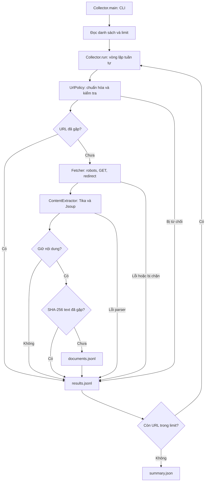

# Thiết kế chi tiết — IT4863 Content Collector

Ngày đối chiếu mã nguồn: **05/09/2026**. Tài liệu mô tả triển khai trong `src/`, không phải đề xuất hệ thống tương lai. Hướng dẫn chạy trên máy mới: [project-context.md](project-context.md).

Xem trước [7 sơ đồ thiết kế có giải thích](design-diagrams.md) nếu muốn hình dung hệ thống trước khi đọc chi tiết.

## 1. Mục tiêu và phạm vi

Project biến danh sách URL HUST có sẵn thành tập văn bản phục vụ bước tìm kiếm sau này. Mỗi URL được kiểm tra, tải, bóc tách, quyết định giữ/bỏ và ghi kết quả có lý do. Văn bản tiếng Việt giữ nguyên dấu.

Đầu vào là một URL hoặc file UTF-8 theo dạng danh sách N06. Đầu ra là JSONL và báo cáo JSON trên ổ đĩa. Chương trình chạy batch tuần tự rồi kết thúc, không có dịch vụ chạy nền.

| Đang có | Chưa triển khai |
|---|---|
| Chuẩn hóa và chống trùng URL | Khám phá link/crawl đệ quy |
| Kiểm tra domain, IP, robots.txt, redirect | Đăng nhập, quản lý phiên người dùng |
| Bóc tách HTML và tài liệu trong allowlist | JavaScript renderer, pipeline OCR được cấu hình/kiểm chứng |
| Lọc bằng quy tắc, hash text | Tìm kiếm, ranking, highlight, index Lucene |
| JSONL và thống kê một lần chạy | Database, REST API, frontend, resume |

README cũ nhắc bản full-stack lưu riêng, nhưng `archive/` bị Git bỏ qua và không có trong checkout đã kiểm tra. Build không phụ thuộc thư mục đó.

## 2. Kiến trúc tổng thể

Các module chạy cùng JVM, gọi phương thức trực tiếp. Chỉ `Fetcher` thực hiện HTTP; `Collector` ghi dữ liệu cuối ra filesystem. Không có queue, giao tiếp mạng nội bộ hoặc persistence ngoài file.

### Stack và đóng gói

Phiên bản lấy từ [pom.xml](../pom.xml), không phải khuyến nghị phiên bản mới nhất.

| Thành phần | Phiên bản | Vai trò |
|---|---|---|
| Java | compiler release 21 | CLI, HTTP client, filesystem, SHA-256 |
| Jsoup | 1.21.2 | Parse DOM và lấy text HTML |
| Apache Tika core + standard parsers | 3.2.3 | Nhận dạng MIME và trích xuất tài liệu |
| crawler-commons | 1.6 | Parse robots.txt |
| Jackson databind | 2.19.2 | Serialize record thành JSON/JSONL |
| Logback classic | 1.5.18 | Log thư viện ra stderr, mức WARN |
| log4j-to-slf4j | 2.24.3 | Chuyển log Log4j sang SLF4J |
| JUnit Jupiter / AssertJ | 5.12.2 / 3.27.4 | Kiểm thử và assertion |

Maven Shade tạo `target/collector.jar` kèm dependency, đặt main class là `vn.edu.hust.collector.Collector`. `ServicesResourceTransformer` gộp khai báo service từ dependency, có ý nghĩa với cơ chế nạp parser Tika. Không cần cài Jsoup/Tika riêng. Repo chưa có Maven Wrapper.

## 3. Module và hợp đồng nội bộ

| Mã nguồn | Phương thức chính | Trách nhiệm |
|---|---|---|
| [Collector.java](../src/main/java/vn/edu/hust/collector/Collector.java) | `main`, `readInput`, `run`, `process`, `fetchWithRetry` | CLI, batch, retry, dedup, đếm và ghi file |
| [UrlPolicy.java](../src/main/java/vn/edu/hust/collector/crawl/UrlPolicy.java) | `normalize`, `inDomain`, `loginUrl`, `checkFetch` | Quy tắc URL và kiểm tra đích tải |
| [Fetcher.java](../src/main/java/vn/edu/hust/collector/crawl/Fetcher.java) | `fetch`, `allowed`, `request` | HTTP, robots cache, redirect, delay, giới hạn byte |
| [ContentExtractor.java](../src/main/java/vn/edu/hust/collector/extract/ContentExtractor.java) | `extract`, `clean` | Nhận dạng, text/title, quyết định giữ/bỏ |

- `Downloader.fetch(url)` là interface nội bộ để truyền cách tải vào Collector. Production dùng retry; test dùng dữ liệu giả, không cần gọi website thật.
- `Fetched(url, status, mime, bytes)` mang phản hồi HTTP cuối về collector.
- `Extracted(title, text, type, keep, reason)` mang kết quả bóc tách và quyết định giữ/bỏ.
- `Outcome(result, document)` ghép báo cáo URL với document tùy chọn; chỉ KEPT tạo document.
- `Result`, `Document`, `Summary` là Java record, xác định trực tiếp tên trường JSON đầu ra.
- `validateDomain` có trong UrlPolicy nhưng CLI chưa gọi. Domain production cố định `hust.edu.vn`.

## 4. CLI và đọc input

| Tham số | Quy tắc |
|---|---|
| `--url` | Một URL, không dùng cùng `--input` |
| `--input` | File UTF-8 tối đa 10 MiB |
| `--limit` | Số dòng URL xử lý; mặc định 100, CLI chấp nhận 1–50.000 |
| `--output` | Thư mục mới; mặc định `output/run-<Instant>` với dấu `:` đổi thành `-` |
| `--help` | In hướng dẫn rồi thoát; không có tham số cũng in help |

CLI nhận cặp option/value, từ chối option lạ/lặp và yêu cầu đúng một trong `--url`, `--input`. Các ràng buộc này nằm ở `main`; gọi `run` trực tiếp từ Java chỉ kiểm tra limit dương, không có trần 50.000.

`readInput` bỏ BOM, strip khoảng trắng và **chỉ giữ dòng bắt đầu chính xác bằng `http://` hoặc `https://` chữ thường**. Dòng giới thiệu, dòng trống, chuỗi thiếu prefix bị bỏ hoàn toàn, không xuất Result. Dòng có prefix nhưng URL sai vẫn vào batch. Một dấu phẩy cuối dòng được bỏ ở `normalize`.

Toàn bộ dòng hợp lệ theo prefix được nạp vào List trước khi áp dụng limit. Limit tính cả URL lỗi/trùng, không phải số document muốn giữ. `remaining` đếm dòng trong List chưa xử lý vì limit, không đếm dòng giới thiệu bị bỏ.

## 5. Luồng một URL

1. `normalize(original)` tạo URL chuẩn hóa; lỗi thì ghi SKIPPED.
2. Kiểm tra domain HUST và mẫu URL đăng nhập.
3. Thêm URL vào `seenUrls`. Nếu đã tồn tại, ghi `DUPLICATE / URL_MATCH`, không tải.
4. Gọi downloader; production áp dụng retry quanh toàn bộ `Fetcher.fetch`.
5. Nhận URL cuối/status/MIME. HTTP khác 200 ghi `FAILED / HTTP_<status>`.
6. Bóc tách. Nếu `keep=false`, ghi SKIPPED với reason của extractor.
7. SHA-256 trên UTF-8 của text đã chuẩn hóa. Hash đã có trong `seenHashes` thì ghi `DUPLICATE / CONTENT_HASH_MATCH`.
8. Tạo document dùng **URL cuối sau redirect**, ghi `KEPT / CONTENT`.
9. Ghi document nếu có, rồi result; flush mỗi record, tăng bộ đếm và in tiến độ.

`seenUrls` được thêm **trước khi tải**: URL tải lỗi ở lần đầu vẫn khiến lần xuất hiện sau bị coi là trùng. Hai URL đầu vào khác nhau cùng redirect về một đích vẫn có thể bị tải lại, rồi mới phát hiện text trùng.

## 6. Chính sách URL

### Chuẩn hóa

- Trim đầu/cuối, bỏ một dấu phẩy cuối; `URI.normalize()` xử lý dot segment.
- Chỉ HTTP/HTTPS, yêu cầu host, không cho user/password trong URL.
- Chuyển scheme/host thành chữ thường; giữ hoa/thường và raw escaping của path.
- Chỉ chấp nhận port mặc định (80 cho HTTP, 443 cho HTTPS), bỏ port đó khỏi kết quả.
- Path rỗng thành `/`; bỏ fragment `#...`.
- Bỏ query dạng `utm_*=...`, `fbclid=...`, `gclid=...`, nhận diện tên không phân biệt hoa/thường; giữ thứ tự và giá trị query khác.

Ví dụ: `https://HUST.edu.vn/a%20b?utm_source=x&page_id=46#top,` thành `https://hust.edu.vn/a%20b?page_id=46`.

Không sắp xếp query, gộp HTTP/HTTPS, gộp www/domain gốc hoặc dùng canonical link HTML. URL dedup chưa bắt mọi URL tương đương.

### Đích tải

Chấp nhận đúng `hust.edu.vn` hoặc host kết thúc `.hust.edu.vn`; không nhận `evilhust.edu.vn` hay `hust.edu.vn.evil.test`. Chặn host bắt đầu `asso.`/`sso.` và path có đoạn `/login`, `/signin`, `/sign-in`, `/adfs` theo regex trong code.

Trước request, resolve tất cả IP của host và từ chối local/loopback/link-local/site-local/multicast, IPv6 ULA, IPv4 dải 100.64.0.0/10. Code chưa pin kết nối vào IP đã kiểm tra, nên đây không phải bảo đảm chống mọi trường hợp DNS thay đổi giữa kiểm tra và kết nối.

## 7. HTTP, robots và retry

| Thiết lập | Giá trị thực tế |
|---|---|
| User-Agent | `HustCourseBot/0.1 (IT4863 educational crawler)` |
| Connect timeout | 10 giây |
| Request timeout | 30 giây |
| Khoảng cách bắt đầu request cùng host | Ít nhất 1.000 ms trong CLI |
| Tài nguyên | Tối đa 20 MiB; kiểm tra Content-Length và số byte thực đọc |
| robots.txt | Tối đa 512.000 byte |
| Redirect | 301, 302, 303, 307, 308; theo tối đa 5 bước |
| Retry | Tối đa 3 lượt tổng cộng; nghỉ 1 giây rồi 2 giây |

HttpClient tắt tự động redirect để kiểm tra lại URL/domain/IP/robots từng đích. Location tương đối được resolve theo URL hiện tại. Thiếu Location thành lỗi exception; vượt giới hạn thành `TOO_MANY_REDIRECTS`.

Robots lấy từ `<scheme>://<authority>/robots.txt`, cache trong RAM theo origin trong lần chạy:

- HTTP 200: parse bằng crawler-commons cho bot `HustCourseBot`.
- HTTP 404: tạo rules cho phép tiếp tục.
- Status khác, kể cả redirect: `ROBOTS_UNAVAILABLE_HTTP_<status>`; không tự theo redirect robots.
- Rule không cho URL: `ROBOTS_DISALLOWED`.
- Crawl-delay lớn hơn delay cấu hình: ngủ thêm `min(crawlDelay, 60.000 ms)` mỗi lần kiểm tra; chưa thực thi nguyên vẹn delay trên 60 giây.

Retry thuộc Collector, áp dụng khi fetch ném IOException hoặc trả 429/status ≥500. Mỗi lượt có thể chạy lại chuỗi redirect. **Robots 429/5xx không qua nhánh retry HTTP**, vì `allowed` ném IllegalArgumentException, collector ghi SKIPPED. Không đọc Retry-After, không retry parser hoặc lỗi policy.

Thời gian đọc body qua InputStream chưa có hard timeout riêng. Không thể suy ra thời gian hoàn thành chỉ từ số URL vì còn mạng, robots, retry và parser.

## 8. Bóc tách và lọc nội dung

### Nhận dạng

Tika detect từ byte và path URL. Chọn nhánh HTML nếu loại detect hoặc MIME HTTP chứa `html`. Tài liệu khác được chấp nhận theo loại Tika detect, không chỉ phần mở rộng/header.

### HTML

1. Jsoup parse byte stream với charset tự nhận diện và base URI là URL cuối.
2. Có `input[type=password]` thì bỏ `LOGIN_REQUIRED`, dù HTTP 200.
3. Xóa `script,style,noscript,nav,header,footer,aside,form,iframe,.breadcrumb,.breadcrumbs,.social-share`.
4. Chọn phần tử khớp đầu tiên trong DOM với selector `article,main,[role=main],.news-content,.detail-content,.entry-content,#news-bodyhtml`; không có thì dùng body. Thứ tự selector không phải cơ chế chấm điểm ưu tiên article hơn main.
5. Text = `clean(main.text())`. Title = h1 đầu tiên còn lại trong document hoặc title; h1 không bắt buộc nằm trong vùng main. Title không gọi clean riêng.
6. Giữ khi `text.length() >= 120` và độ dài text trong thẻ a `< 0,55 × text.length()`.
7. Title chữ thường chứa `404`, `page not found` hoặc `access denied` luôn bị `SOFT_ERROR`.

Text rỗng trả `EMPTY_OR_JS_REQUIRED`; ngắn/nhiều link trả `SHORT_OR_LINK_LIST`. Đây là heuristic, không chứng minh trang cần JavaScript và không bảo đảm danh mục luôn bị bỏ. `String.length()` dùng đơn vị UTF-16 của Java.

### Tài liệu

Allowlist nhận PDF, MIME chứa `officedocument`, `msword`, `ms-excel`, `ms-powerpoint`, `opendocument`, hoặc đúng `application/rtf`. Loại khác bị `UNSUPPORTED_TYPE`, bao gồm text thuần ở triển khai hiện tại.

Tika `parseToString` được gọi với giới hạn 2.000.000 ký tự và Metadata. Title lấy `dc:title`, thiếu thì lấy path URL. Text không rỗng là đủ để giữ, không áp ngưỡng HTML 120 ký tự. Text rỗng trả `EMPTY_OR_NEEDS_OCR`. Lỗi parser đi về FAILED, không đổi thành text rỗng. Chưa có trường đầu ra riêng báo tài liệu chạm giới hạn text.

Project chưa cấu hình/kiểm chứng pipeline OCR, chưa cách ly parser hoặc áp hard timeout cho Tika. Không nên kỳ vọng đọc đầy đủ PDF scan.

### Chuẩn hóa và hash

`clean` chuyển Unicode NFC, gộp chuỗi whitespace/ký tự phân cách Unicode thành một dấu cách, strip đầu/cuối. Không bỏ dấu, stemming hay tokenization. Xuống dòng/cấu trúc bảng/đoạn văn không giữ trong text cuối.

Hash là SHA-256 trên UTF-8 của **text sau clean**, biểu diễn hex chữ thường. URL/title/MIME không tham gia hash. Khác metadata nhưng text giống nhau chỉ giữ bản xuất hiện trước. Chỉ phát hiện trùng chính xác trong một batch, không gần trùng hoặc so với lần chạy cũ.

## 9. Hợp đồng dữ liệu đầu ra

JSONL UTF-8 có một object trên mỗi dòng, không phải mảng JSON. Tên trường lấy trực tiếp từ Java record; chưa có schema version.

### documents.jsonl — chỉ nội dung KEPT

| Trường | Kiểu | Ý nghĩa |
|---|---|---|
| `url` | string | URL cuối sau redirect |
| `title` | string | Tiêu đề HTML hoặc metadata/path tài liệu; có thể rỗng |
| `text` | string | Nội dung chuẩn hóa, không rỗng |
| `contentType` | string | text/html hoặc loại Tika detect |
| `contentHash` | string | SHA-256 text, 64 ký tự hex |
| `fetchedAt` | string | UTC ISO-8601, tạo sau bóc tách/hash, không phải Last-Modified của nguồn |

### results.jsonl — mỗi dòng URL đã xử lý

| Trường | Kiểu | Ý nghĩa |
|---|---|---|
| `originalUrl` | string | Chuỗi vào process; với file đã bỏ BOM/strip, có thể còn dấu phẩy |
| `url` | string/null | URL chuẩn hóa; null nếu bước đó chưa thành công |
| `finalUrl` | string/null | URL Fetcher trả về; null nếu Fetcher chưa trả được phản hồi |
| `httpStatus` | integer/null | Status Fetcher trả về, không phải lịch sử redirect/robots |
| `status` | string | KEPT, SKIPPED, DUPLICATE, FAILED |
| `reason` | string | Mã lý do hoặc message exception |
| `contentType` | string/null | MIME HTTP; thay bằng MIME extractor khi bóc tách xong; HTTP lỗi hiện trả chuỗi rỗng |
| `contentHash` | string/null | Có ở KEPT và trùng text; không có ở trùng URL/lỗi/bị bỏ |

Exception trong Fetcher có thể làm httpStatus vẫn null dù đã có request, vì chưa trả Fetched về Collector. Result không lưu lịch sử request.

### Status và reason thường gặp

| Status | Reason | Diễn giải |
|---|---|---|
| KEPT | `CONTENT` | Document được ghi |
| DUPLICATE | `URL_MATCH` | URL chuẩn hóa đã gặp, chưa tải lại |
| DUPLICATE | `CONTENT_HASH_MATCH` | Text giống hệt sau tải/bóc tách |
| SKIPPED | `OUTSIDE_DOMAIN` / `Outside crawl domain` | Domain đầu vào / đích tải không hợp lệ |
| SKIPPED | `LOGIN_REQUIRED` | URL hoặc form có dấu hiệu đăng nhập |
| SKIPPED | `ROBOTS_DISALLOWED` / `ROBOTS_UNAVAILABLE_HTTP_*` | Robots không cho phép hoặc không đọc được theo policy |
| SKIPPED | `DOWNLOAD_TOO_LARGE` / `TOO_MANY_REDIRECTS` | Vượt giới hạn |
| SKIPPED | `SHORT_OR_LINK_LIST` / `EMPTY_OR_JS_REQUIRED` / `SOFT_ERROR` | HTML không đạt quy tắc |
| SKIPPED | `UNSUPPORTED_TYPE` / `EMPTY_OR_NEEDS_OCR` | Loại chưa hỗ trợ / text rỗng |
| FAILED | `HTTP_<status>` | Phản hồi tài nguyên cuối khác 200 |
| FAILED | `<ExceptionClass>: <message>` | I/O, DNS, parser hoặc lỗi khác |

Reason chưa phải enum ổn định. IllegalArgumentException ở bất kỳ bước nào trong process đều thành SKIPPED với message gốc, ví dụ `Unsupported port`, `Non-public address`, `robots.txt too large`. Exception khác thành FAILED. Khi thống kê nên nhóm status trước, xem reason sau.

### summary.json

| Trường | Ý nghĩa |
|---|---|
| `processed` | Số dòng URL đã xử lý và ghi kết quả |
| `kept`, `skipped`, `duplicate`, `failed` | Bộ đếm từng status |
| `remaining` | Dòng đã đọc vào List nhưng nằm ngoài limit |

Kết thúc bình thường: `processed = kept + skipped + duplicate + failed`; số dòng documents bằng kept, số dòng results bằng processed. Summary chỉ viết sau vòng lặp.

## 10. Ghi file, trạng thái và lỗi batch

Output phải chưa tồn tại, kể cả thư mục rỗng. File JSONL mở với CREATE_NEW. Mỗi URL ghi document trước nếu có, rồi result, flush ngay. Cách này giữ phần đã xử lý khi bị ngắt nhưng **không phải transaction** giữa hai file, không có fsync bảo đảm dữ liệu sau sự cố hệ thống.

Nếu ngắt giữa hai lần ghi, document có thể chưa có result tương ứng; dòng cuối cần kiểm tra tính toàn vẹn. Lỗi filesystem thoát ngoài process, dừng batch, có thể thiếu summary. Không có checkpoint/resume.

Lỗi từng URL thường được đổi thành Result để tiếp tục. Batch có FAILED vẫn có thể exit code 0. `main` chỉ gọi `System.exit(1)` khi có exception thoát ra ngoài như lỗi tham số/input/output. Script tự động phải đọc summary nếu muốn xem lỗi từng URL là job thất bại.

Trạng thái RAM gồm List input, tập URL/hash, cache robots và thời điểm request theo host. Byte tài nguyên được giữ trong RAM để parse; không lưu raw HTML/PDF. Code/collection hiện tại chưa thiết kế cho xử lý đa luồng.

## 11. Mẫu thực tế đã commit

[Input mẫu](../output/demo-input.txt) có 6 dòng. [Summary mẫu](../output/demo-n06/summary.json) ghi 6 processed, 3 kept, 1 skipped, 2 duplicate, 0 failed:

| Dòng | Trường hợp | Kết quả đã lưu |
|---|---|---|
| 1 | Giới thiệu ACT | KEPT, HTML |
| 2 | Bài viết SOICT | KEPT, HTML |
| 3 | PDF FAQ thực tập doanh nghiệp | KEPT, PDF |
| 4 | ACT /vi/about/ về cùng bài dòng 1 | DUPLICATE, CONTENT_HASH_MATCH |
| 5 | URL ASSO | SKIPPED, LOGIN_REQUIRED |
| 6 | Lặp URL dòng 1 | DUPLICATE, URL_MATCH |

Đây là dữ liệu lịch sử, không bảo đảm website hiện trả giống hệt. `documents.pretty.json` và `document-1.txt`…`document-3.txt` là bản đọc thuận tiện có sẵn trong mẫu; CLI chỉ tự sinh ba file chuẩn. Mẫu này chưa chứng minh độ chính xác trên toàn N06.

## 12. Điểm sửa và kiểm chứng

| Muốn thay đổi | Điểm bắt đầu | Kiểm chứng |
|---|---|---|
| Option, limit, schema, dedup | Collector | CollectorTest và JAR/input nhỏ |
| Query, domain, login URL | UrlPolicy | UrlPolicyTest, không phá query định danh |
| Retry | Collector.fetchWithRetry | Cần fixture retry, hiện chưa có test riêng |
| Robots, redirect, size, delay | Fetcher | FetcherTest với server cục bộ |
| Vùng nội dung, ngưỡng giữ/bỏ | ContentExtractor | ContentExtractorTest và HTML có nhãn |
| Loại tài liệu mới | Allowlist extractor, dependency nếu cần | Fixture định dạng đó và JAR đóng gói |

Hướng mở rộng đề xuất, **chưa triển khai**: đánh giá mẫu nhiều subdomain/định dạng trước khi chỉnh heuristic; thêm test retry/lỗi; manifest lần chạy/schema version nếu cần tái lập; checkpoint/raw storage nếu chạy dài; sau đó dùng documents cho index tìm kiếm. Sửa normalization sẽ ảnh hưởng hash/dedup nên cần đánh giá lại mẫu.

Phạm vi kiểm thử và hạn chế xác minh: [validation.md](validation.md).
