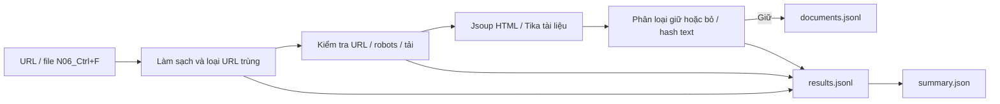

# Kiến trúc theo phạm vi đề bài

Một chương trình Java xử lý tuần tự danh sách đã có. Không có server, queue database, index tìm kiếm hoặc giao diện.

## Luồng xử lý

1. Nhận một URL hoặc file UTF-8 tối đa 10 MiB. Bỏ dòng giới thiệu N06, BOM và dấu phẩy phân cách cuối dòng.
2. Chuẩn hóa hostname/protocol/path; bỏ fragment/tracking phổ biến, giữ query định danh như page_id. Giới hạn HTTP(S), domain HUST, đích công khai; chặn URL login/SSO.
3. Loại URL trùng, kiểm tra robots rồi GET; kiểm tra domain từng redirect. Robots 404 cho phép tiếp tục; 200 được phân tích; trạng thái khác ghi lý do và bỏ URL. Chưa theo redirect riêng cho robots.
4. HTTP khác 200 ghi FAILED. HTTP 200 còn được kiểm tra vì có thể trả login hoặc lỗi mềm.
5. HTML: kiểm tra password form, bỏ script/style/menu/header/footer; lấy h1/title, ưu tiên article/main/vùng nội dung phổ biến rồi fallback body. Giữ khi text ≥120 ký tự, tỷ lệ text trong liên kết <55%, không có dấu hiệu lỗi trong title. Đây là heuristic khởi đầu, chưa đánh giá chất lượng trên N06.
6. Tika đọc PDF/Office/ODF/RTF. Định dạng khác ghi UNSUPPORTED_TYPE; text rỗng ghi EMPTY_OR_NEEDS_OCR. Lỗi parser ghi FAILED, không coi là tài liệu vô ích.
7. Chuẩn hóa NFC/khoảng trắng, giữ dấu tiếng Việt. SHA-256 trên text loại nội dung trùng trong batch.
8. Ghi kết quả cho mỗi URL đã xử lý; chỉ KEPT có record văn bản. Ghi summary khi kết thúc.

Phân loại HTML cần xem text bóc tách sơ bộ để quyết định giữ/bỏ; hai thao tác cùng nằm trong ContentExtractor. Không lưu raw bytes, không khám phá link mới.

## Module

| File | Trách nhiệm |
|---|---|
| Collector | CLI, danh sách, retry tải, chống trùng, điều phối, xuất JSONL |
| UrlPolicy | Chuẩn hóa, domain/protocol, đích công khai/login |
| Fetcher | HTTP, robots, redirect, độ trễ, giới hạn kích thước |
| ContentExtractor | Nhận dạng, title/text và quyết định giữ/bỏ |

Phần web/search cũ cất tại archive/previous-full-stack, không phải module Maven. JSONL có thể dùng cho bài index/search sau.

## Giới hạn cần nêu trong báo cáo

- Chưa đánh giá toàn N06. Lấy mẫu nhiều subdomain/định dạng, gán nhãn giữ/bỏ để đo tỷ lệ đúng; kiểm tra mất nội dung và lẫn menu riêng.
- Chưa OCR/JavaScript renderer. SHORT_OR_LINK_LIST hoặc EMPTY_OR_JS_REQUIRED là tín hiệu cần xem lại, không chứng minh trang cần JavaScript.
- Timeout kết nối 10s, HTTP 30s. Timeout JDK dùng stream chưa là hạn cứng toàn bộ đọc body; Tika chưa có hard timeout/cách ly parser. Nên chạy mẫu trước.
- Chưa resume, raw storage, Retry-After hoặc loại gần trùng. Bị ngắt vẫn giữ record đã flush; chạy tiếp cần danh sách phần còn lại và thư mục mới.
- Chống trùng chỉ trong một lần chạy, không theo dõi thay đổi giữa các lần.

Tài liệu: [Jsoup](https://jsoup.org/cookbook/extracting-data/), [Apache Tika](https://tika.apache.org/3.2.3/).
