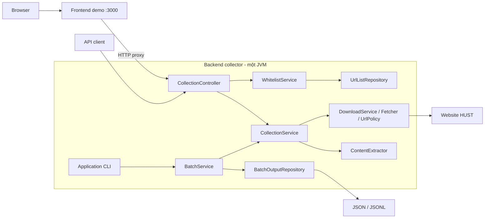

# Kiến trúc backend collector

Cập nhật theo refactor ngày 10/09/2026. Hệ thống có **một backend triển khai độc lập**.
Các layer bên dưới là package trong cùng JVM, không phải các microservice riêng.
Frontend demo là ứng dụng độc lập, có thể bỏ khỏi deployment.

## 1. Phạm vi

URL HUST → tải có policy → bóc tách title/text/link/ảnh → trả API hoặc xuất batch JSON/JSONL.
Tìm kiếm Lucene/TF-IDF nằm trong cùng backend, chi tiết tại [search.md](search.md).
Chưa thêm database, message broker, authentication, OCR hoặc crawl đệ quy.
Repository hiện truy cập filesystem/classpath; không tạo repository database giả.

## 2. Ranh giới triển khai

API không lưu output; CLI batch sở hữu phiên ghi output qua repository.
Không có shared database hoặc HTTP nội bộ giữa download/parser.
Maven aggregator root có đúng một module `backend`. Backend có POM, Dockerfile,
entry point và health check riêng. Demo nằm trong profile Compose `demo` tùy chọn.

## 3. Layer và dependency

| Package/class | Trách nhiệm |
|---|---|
| `Application` | `@SpringBootApplication`, chọn chế độ API/CLI, parse option |
| `config` | Khai báo Spring bean, SERVER_HOST/SERVER_PORT và container health probe |
| `controller` | Spring MVC routing, Bean Validation, HTTP status và backpressure |
| `dto` | Hợp đồng response HTTP |
| `service/CollectionService` | Policy đầu vào và pipeline download/parser dùng chung |
| `service/DownloadService` | Retry I/O/429/5xx quanh Fetcher |
| `service/BatchService` | Vòng lặp URL, dedup URL/text, status và summary |
| `service/WhitelistService` | Tìm tối đa 20 gợi ý trong whitelist |
| `repository/UrlListRepository` | Đọc whitelist classpath và file TXT batch |
| `repository/BatchOutputRepository` | Mở output mới, serialize, flush và đóng tài nguyên |
| `model` | Link, FetchedContent, ExtractedContent, Document, CollectionResult, BatchSummary, CollectionOutcome |
| `crawl` | HTTP/robots/redirect/giới hạn tải và URL/IP policy |
| `extract` | Jsoup/Tika và quy tắc nội dung |

Controller không tải HTTP đích, không gọi parser trực tiếp và không thao tác filesystem.
Service không phụ thuộc Servlet API. Repository không phụ thuộc controller/service.
`Downloader` là điểm tiêm fixture cho test. Các model không chứa logic transport hoặc lưu trữ.

Giữ nguyên Java release 21, Jsoup 1.21.2, Tika 3.2.3, crawler-commons 1.6 và Jackson 2.19.2.
Dependency đầy đủ: [backend/pom.xml](../backend/pom.xml).
Spring Boot Maven Plugin tạo executable JAR `backend/target/collector.jar`, main
`vn.edu.hust.collector.Application`. JAR không có HTML/CSS/JS của demo.

## 4. Các chế độ đầu vào

| Tham số | Quy tắc |
|---|---|
| `--url` | Một URL, không dùng cùng `--input` |
| `--input` | File UTF-8 tối đa 10 MiB |
| `--limit` | Số dòng URL xử lý; mặc định 100, CLI chấp nhận 1–50.000 |
| `--output` | Thư mục mới; mặc định `output/run-<Instant>` với dấu `:` đổi thành `-` |
| `--help` | In hướng dẫn rồi thoát; không có tham số thì chạy API |
| `--serve [port]` | Chạy backend API; port mặc định 8080, frontend riêng tại 3000 |
| `--health-check` | Probe nội bộ `/health` cho Docker HEALTHCHECK |

Ngoài nhánh đặc biệt `--serve [port]`, CLI nhận cặp option/value, từ chối option lạ/lặp và yêu cầu đúng một trong `--url`, `--input`. Các ràng buộc này nằm ở `main`; `BatchService.run` cũng kiểm tra limit 1–50.000.

### Chế độ API và frontend demo

Backend mặc định bind loopback, có thể cấu hình host/port bằng environment.
`CollectionController` chỉ xử lý JSON và gọi service, không đọc resource UI.
Spring MVC nhận request; semaphore giới hạn một request thu thập đang chạy, request tiếp theo
nhận HTTP 429 thay vì chờ vô hạn. Actuator health và whitelist vẫn phục vụ đồng thời.
`CollectionService` đồng bộ truy cập Fetcher/parser để giữ an toàn cache theo host.

Endpoint, status, validation và compatibility alias được mô tả tại [api.md](api.md).
Frontend là client tùy chọn trong `frontend/demo`; Node chỉ serve static/proxy API.
TXT import vẫn được đọc trong trình duyệt, không upload hoặc tự chạy batch.

### Đọc input CLI

`readInput` bỏ BOM, strip khoảng trắng và **chỉ giữ dòng bắt đầu chính xác bằng `http://` hoặc `https://` chữ thường**. Dòng giới thiệu, dòng trống, chuỗi thiếu prefix bị bỏ hoàn toàn, không xuất Result. Dòng có prefix nhưng URL sai vẫn vào batch. Một dấu phẩy cuối dòng được bỏ ở `normalize`.

Toàn bộ dòng hợp lệ theo prefix được nạp vào List trước khi áp dụng limit. Limit tính cả URL lỗi/trùng, không phải số document muốn giữ. `remaining` đếm dòng trong List chưa xử lý vì limit, không đếm dòng giới thiệu bị bỏ.

## 5. Luồng một URL

1. `normalize(original)` tạo URL chuẩn hóa; lỗi thì ghi SKIPPED.
2. Kiểm tra domain HUST và mẫu URL đăng nhập.
3. Thêm URL vào `seenUrls`. Nếu đã tồn tại, ghi `DUPLICATE / URL_MATCH`, không tải.
4. Gọi downloader; production áp dụng retry quanh toàn bộ `Fetcher.fetch`.
5. Nhận URL cuối/status/MIME. HTTP khác 200 ghi `FAILED / HTTP_<status>`.
6. Bóc tách. Nếu `keep=false`, ghi SKIPPED với reason của extractor.
7. SHA-256 trên UTF-8 của text đã chuẩn hóa. Hash đã có trong `seenHashes` thì ghi `DUPLICATE / CONTENT_HASH_MATCH`.
8. Tạo document dùng **URL cuối sau redirect**, ghi `KEPT / CONTENT`.
9. Ghi document nếu có, rồi result; flush mỗi record, tăng bộ đếm và in tiến độ.

`seenUrls` được thêm **trước khi tải**: URL tải lỗi ở lần đầu vẫn khiến lần xuất hiện sau bị coi là trùng. Hai URL đầu vào khác nhau cùng redirect về một đích vẫn có thể bị tải lại, rồi mới phát hiện text trùng.

## 6. Chính sách URL

### Chuẩn hóa

- Trim đầu/cuối, bỏ một dấu phẩy cuối; `URI.normalize()` xử lý dot segment.
- Chỉ HTTP/HTTPS, yêu cầu host, không cho user/password trong URL.
- Chuyển scheme/host thành chữ thường; giữ hoa/thường và raw escaping của path.
- Chỉ chấp nhận port mặc định (80 cho HTTP, 443 cho HTTPS), bỏ port đó khỏi kết quả.
- Path rỗng thành `/`; bỏ fragment `#...`.
- Bỏ query dạng `utm_*=...`, `fbclid=...`, `gclid=...`, nhận diện tên không phân biệt hoa/thường; giữ thứ tự và giá trị query khác.

Ví dụ: `https://HUST.edu.vn/a%20b?utm_source=x&page_id=46#top,` thành `https://hust.edu.vn/a%20b?page_id=46`.

Không sắp xếp query, gộp HTTP/HTTPS, gộp www/domain gốc hoặc dùng canonical link HTML. URL dedup chưa bắt mọi URL tương đương.

### Đích tải

Chấp nhận đúng `hust.edu.vn` hoặc host kết thúc `.hust.edu.vn`; không nhận `evilhust.edu.vn` hay `hust.edu.vn.evil.test`. Chặn host bắt đầu `asso.`/`sso.` và path có đoạn `/login`, `/signin`, `/sign-in`, `/adfs` theo regex trong code.

Trước request, resolve tất cả IP của host và từ chối local/loopback/link-local/site-local/multicast, IPv6 ULA, IPv4 dải 100.64.0.0/10. Code chưa pin kết nối vào IP đã kiểm tra, nên đây không phải bảo đảm chống mọi trường hợp DNS thay đổi giữa kiểm tra và kết nối.

## 7. HTTP, robots và retry

| Thiết lập | Giá trị thực tế |
|---|---|
| User-Agent | `HustCourseBot/0.1 (IT4863 educational crawler)` |
| Connect timeout | 10 giây |
| Request timeout | 30 giây |
| Khoảng cách bắt đầu request cùng host | Ít nhất 1.000 ms trong CLI |
| Tài nguyên | Tối đa 20 MiB; kiểm tra Content-Length và số byte thực đọc |
| robots.txt | Tối đa 512.000 byte |
| Redirect | 301, 302, 303, 307, 308; theo tối đa 5 bước |
| Retry | Tối đa 3 lượt tổng cộng; nghỉ 1 giây rồi 2 giây |

HttpClient tắt tự động redirect để kiểm tra lại URL/domain/IP/robots từng đích. Location tương đối được resolve theo URL hiện tại. Thiếu Location thành lỗi exception; vượt giới hạn thành `TOO_MANY_REDIRECTS`.

Robots lấy từ `<scheme>://<authority>/robots.txt`, cache trong RAM theo origin trong lần chạy:

- HTTP 200: parse bằng crawler-commons cho bot `HustCourseBot`.
- HTTP 404: tạo rules cho phép tiếp tục.
- Status khác, kể cả redirect: `ROBOTS_UNAVAILABLE_HTTP_<status>`; không tự theo redirect robots.
- Rule không cho URL: `ROBOTS_DISALLOWED`.
- Crawl-delay lớn hơn delay cấu hình: ngủ thêm `min(crawlDelay, 60.000 ms)` mỗi lần kiểm tra; chưa thực thi nguyên vẹn delay trên 60 giây.

Retry thuộc Collector, áp dụng khi fetch ném IOException hoặc trả 429/status ≥500. Mỗi lượt có thể chạy lại chuỗi redirect. **Robots 429/5xx không qua nhánh retry HTTP**, vì `allowed` ném IllegalArgumentException, collector ghi SKIPPED. Không đọc Retry-After, không retry parser hoặc lỗi policy.

Thời gian đọc body qua InputStream chưa có hard timeout riêng. Không thể suy ra thời gian hoàn thành chỉ từ số URL vì còn mạng, robots, retry và parser.

## 8. Bóc tách và lọc nội dung

### Nhận dạng

Tika detect từ byte và path URL. Chọn nhánh HTML nếu loại detect hoặc MIME HTTP chứa `html`. Tài liệu khác được chấp nhận theo loại Tika detect, không chỉ phần mở rộng/header.

### HTML

1. Jsoup parse byte stream với charset tự nhận diện và base URI là URL cuối.
2. Có `input[type=password]` thì bỏ `LOGIN_REQUIRED`, dù HTTP 200.
3. Xóa `script,style,noscript,nav,header,footer,aside,form,iframe,.breadcrumb,.breadcrumbs,.social-share,.share-icons`.
4. Thử selector theo thứ tự ưu tiên: `#news-bodyhtml`, `.entry-content`, `.elementor-widget-theme-post-content`, `.news-content`, `.detail-content`, `article`, `main`, `[role=main]`; không có thì dùng body.
5. Text = `clean(main.text())`. Title lấy h1 đầu tiên hoặc title trước khi xóa vùng phụ và được clean. Trong vùng chính, lấy liên kết và nguồn ảnh HTTP(S) đầy đủ kèm mô tả; xem [quy tắc liên kết](demo.md).
6. Giữ khi `text.length() >= 120` và độ dài text trong thẻ a `< 0,55 × text.length()`.
7. Title chữ thường chứa `404`, `page not found` hoặc `access denied` luôn bị `SOFT_ERROR`.

Text rỗng trả `EMPTY_OR_JS_REQUIRED`; ngắn/nhiều link trả `SHORT_OR_LINK_LIST`. Đây là heuristic, không chứng minh trang cần JavaScript và không bảo đảm danh mục luôn bị bỏ. `String.length()` dùng đơn vị UTF-16 của Java.

### Liên kết và ảnh

Extractor duyệt `a[href]` và các ảnh có `src`, `data-src`, `data-lazy-src` hoặc `data-original` theo thứ tự DOM. URL được resolve bằng base URI của Jsoup và chỉ giữ HTTP(S) không có credentials.

- Link: mô tả ưu tiên anchor text → `aria-label` → `alt` ảnh con → `title`.
- Ảnh: URL ưu tiên `data-src` → `data-lazy-src` → `data-original` → `src`.
- Ảnh: mô tả ưu tiên `alt` → `figcaption` gần nhất → `title`.
- `LinkedHashSet<Link>` loại cặp URL/text trùng và giữ thứ tự đầu tiên.

Một ảnh nằm trong thẻ `a` có thể tạo hai phần tử: URL đích của thẻ `a` và URL file ảnh. Text mô tả có thể rỗng. Extractor không crawl hoặc tải các URL tìm thấy.

### Tài liệu

Allowlist nhận PDF, MIME chứa `officedocument`, `msword`, `ms-excel`, `ms-powerpoint`, `opendocument`, hoặc đúng `application/rtf`. Loại khác bị `UNSUPPORTED_TYPE`, bao gồm text thuần ở triển khai hiện tại.

Tika `parseToString` được gọi với giới hạn 2.000.000 ký tự và Metadata. Title lấy `dc:title`, thiếu thì lấy path URL. Text không rỗng là đủ để giữ, không áp ngưỡng HTML 120 ký tự. Text rỗng trả `EMPTY_OR_NEEDS_OCR`. Lỗi parser đi về FAILED, không đổi thành text rỗng. Chưa có trường đầu ra riêng báo tài liệu chạm giới hạn text.

Project chưa cấu hình/kiểm chứng pipeline OCR, chưa cách ly parser hoặc áp hard timeout cho Tika. Không nên kỳ vọng đọc đầy đủ PDF scan.

### Chuẩn hóa và hash

`clean` chuyển Unicode NFC, gộp chuỗi whitespace/ký tự phân cách Unicode thành một dấu cách, strip đầu/cuối. Không bỏ dấu, stemming hay tokenization. Xuống dòng/cấu trúc bảng/đoạn văn không giữ trong text cuối.

Hash là SHA-256 trên UTF-8 của **text sau clean**, biểu diễn hex chữ thường. URL/title/MIME không tham gia hash. Khác metadata nhưng text giống nhau chỉ giữ bản xuất hiện trước. Chỉ phát hiện trùng chính xác trong một batch, không gần trùng hoặc so với lần chạy cũ.

## 9. Hợp đồng dữ liệu đầu ra

JSONL UTF-8 có một object trên mỗi dòng, không phải mảng JSON. Tên trường lấy trực tiếp từ Java record; chưa có schema version.

### documents.json và documents.jsonl — chỉ nội dung KEPT

| Trường | Kiểu | Ý nghĩa |
|---|---|---|
| `url` | string | URL cuối sau redirect |
| `title` | string | Tiêu đề HTML hoặc metadata/path tài liệu; có thể rỗng |
| `text` | string | Nội dung chuẩn hóa, không rỗng |
| `links` | array | Các object `{url, text}` của liên kết/ảnh trong vùng bài; PDF/Office hiện rỗng |
| `contentType` | string | text/html hoặc loại Tika detect |
| `contentHash` | string | SHA-256 text, 64 ký tự hex |
| `fetchedAt` | string | UTC ISO-8601, tạo sau bóc tách/hash, không phải Last-Modified của nguồn |

`documents.json` xuất cùng record dưới dạng mảng có thụt dòng để trình diễn. Mảng chỉ hoàn tất khi batch kết thúc bình thường; JSONL thích hợp đọc tiến độ hoặc kết quả bị ngắt.

### results.jsonl — mỗi dòng URL đã xử lý

| Trường | Kiểu | Ý nghĩa |
|---|---|---|
| `originalUrl` | string | Chuỗi vào process; với file đã bỏ BOM/strip, có thể còn dấu phẩy |
| `url` | string/null | URL chuẩn hóa; null nếu bước đó chưa thành công |
| `finalUrl` | string/null | URL Fetcher trả về; null nếu Fetcher chưa trả được phản hồi |
| `httpStatus` | integer/null | Status Fetcher trả về, không phải lịch sử redirect/robots |
| `status` | string | KEPT, SKIPPED, DUPLICATE, FAILED |
| `reason` | string | Mã lý do hoặc message exception |
| `contentType` | string/null | MIME HTTP; thay bằng MIME extractor khi bóc tách xong; HTTP lỗi hiện trả chuỗi rỗng |
| `contentHash` | string/null | Có ở KEPT và trùng text; không có ở trùng URL/lỗi/bị bỏ |

Exception trong Fetcher có thể làm httpStatus vẫn null dù đã có request, vì chưa trả Fetched về Collector. Result không lưu lịch sử request.

### Status và reason thường gặp

| Status | Reason | Diễn giải |
|---|---|---|
| KEPT | `CONTENT` | Document được ghi |
| DUPLICATE | `URL_MATCH` | URL chuẩn hóa đã gặp, chưa tải lại |
| DUPLICATE | `CONTENT_HASH_MATCH` | Text giống hệt sau tải/bóc tách |
| SKIPPED | `OUTSIDE_DOMAIN` / `Outside crawl domain` | Domain đầu vào / đích tải không hợp lệ |
| SKIPPED | `LOGIN_REQUIRED` | URL hoặc form có dấu hiệu đăng nhập |
| SKIPPED | `ROBOTS_DISALLOWED` / `ROBOTS_UNAVAILABLE_HTTP_*` | Robots không cho phép hoặc không đọc được theo policy |
| SKIPPED | `DOWNLOAD_TOO_LARGE` / `TOO_MANY_REDIRECTS` | Vượt giới hạn |
| SKIPPED | `SHORT_OR_LINK_LIST` / `EMPTY_OR_JS_REQUIRED` / `SOFT_ERROR` | HTML không đạt quy tắc |
| SKIPPED | `UNSUPPORTED_TYPE` / `EMPTY_OR_NEEDS_OCR` | Loại chưa hỗ trợ / text rỗng |
| FAILED | `HTTP_<status>` | Phản hồi tài nguyên cuối khác 200 |
| FAILED | `<ExceptionClass>: <message>` | I/O, DNS, parser hoặc lỗi khác |

Reason chưa phải enum ổn định. IllegalArgumentException ở bất kỳ bước nào trong process đều thành SKIPPED với message gốc, ví dụ `Unsupported port`, `Non-public address`, `robots.txt too large`. Exception khác thành FAILED. Khi thống kê nên nhóm status trước, xem reason sau.

### summary.json

| Trường | Ý nghĩa |
|---|---|
| `processed` | Số dòng URL đã xử lý và ghi kết quả |
| `kept`, `skipped`, `duplicate`, `failed` | Bộ đếm từng status |
| `remaining` | Dòng đã đọc vào List nhưng nằm ngoài limit |

Kết thúc bình thường: `processed = kept + skipped + duplicate + failed`; số dòng documents bằng kept, số dòng results bằng processed. Summary chỉ viết sau vòng lặp.

## 10. Ghi file, trạng thái và lỗi batch

Output phải chưa tồn tại, kể cả thư mục rỗng. File JSONL mở với CREATE_NEW. Mỗi URL ghi document trước nếu có, rồi result, flush ngay. Cách này giữ phần đã xử lý khi bị ngắt nhưng **không phải transaction** giữa hai file, không có fsync bảo đảm dữ liệu sau sự cố hệ thống.

Nếu ngắt giữa hai lần ghi, document có thể chưa có result tương ứng; dòng cuối cần kiểm tra tính toàn vẹn. Lỗi filesystem thoát ngoài process, dừng batch, có thể thiếu summary. Không có checkpoint/resume.

Lỗi từng URL thường được đổi thành Result để tiếp tục. Batch có FAILED vẫn có thể exit code 0. `Application.main` chỉ gọi `System.exit(1)` khi có exception thoát ra ngoài như lỗi tham số/input/output. Script tự động phải đọc summary nếu muốn xem lỗi từng URL là job thất bại.

Trạng thái RAM gồm List input, tập URL/hash, cache robots và thời điểm request theo host. Byte tài nguyên được giữ trong RAM để parse; không lưu raw HTML/PDF. Batch chạy tuần tự; API giới hạn một request thu thập và vẫn phục vụ health/whitelist đồng thời.

## 11. Mẫu thực tế đã commit

[Input mẫu](../output/demo-input.txt) có 6 dòng. [Summary mẫu](../output/demo-n06/summary.json) ghi 6 processed, 3 kept, 1 skipped, 2 duplicate, 0 failed:

| Dòng | Trường hợp | Kết quả đã lưu |
|---|---|---|
| 1 | Giới thiệu ACT | KEPT, HTML |
| 2 | Bài viết SOICT | KEPT, HTML |
| 3 | PDF FAQ thực tập doanh nghiệp | KEPT, PDF |
| 4 | ACT /vi/about/ về cùng bài dòng 1 | DUPLICATE, CONTENT_HASH_MATCH |
| 5 | URL ASSO | SKIPPED, LOGIN_REQUIRED |
| 6 | Lặp URL dòng 1 | DUPLICATE, URL_MATCH |

Đây là dữ liệu lịch sử, không bảo đảm website hiện trả giống hệt. `documents.pretty.json` và `document-1.txt`…`document-3.txt` là bản đọc thuận tiện có sẵn trong mẫu; CLI sinh bốn file chuẩn. Mẫu này chưa chứng minh độ chính xác trên toàn N06.

## 12. Điểm sửa và kiểm chứng

| Muốn thay đổi | Điểm bắt đầu | Kiểm chứng |
|---|---|---|
| Option, limit, schema, dedup | Application / BatchService / BatchOutputRepository | BatchServiceTest và JAR/input nhỏ |
| Query, domain, login URL | UrlPolicy | UrlPolicyTest, không phá query định danh |
| Retry | DownloadService.fetch | Cần fixture retry, hiện chưa có test riêng |
| Robots, redirect, size, delay | Fetcher | FetcherTest với server cục bộ |
| Vùng nội dung, ngưỡng giữ/bỏ | ContentExtractor | ContentExtractorTest và HTML có nhãn |
| Loại tài liệu mới | Allowlist extractor, dependency nếu cần | Fixture định dạng đó và JAR đóng gói |
| Whitelist, import TXT, giao diện/API | CollectionController, WhitelistService và `frontend/demo/` | ApplicationTest, `node --check` và smoke test trình duyệt |

Hướng mở rộng đề xuất, **chưa triển khai**: đánh giá mẫu nhiều subdomain/định dạng trước khi chỉnh heuristic; thêm test retry/lỗi; manifest lần chạy/schema version nếu cần tái lập; checkpoint/raw storage nếu chạy dài. Tìm kiếm Lucene/TF-IDF đã được triển khai, xem [search.md](search.md). Sửa normalization sẽ ảnh hưởng hash/dedup nên cần đánh giá lại mẫu.

Phạm vi kiểm thử và hạn chế xác minh: [validation.md](validation.md).
