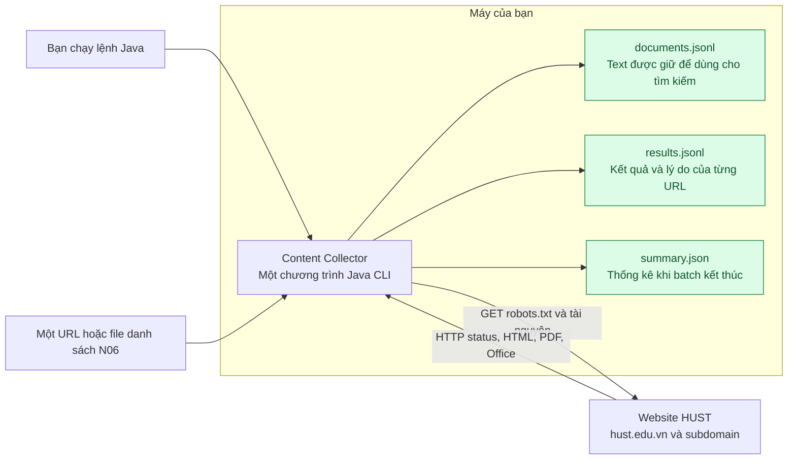
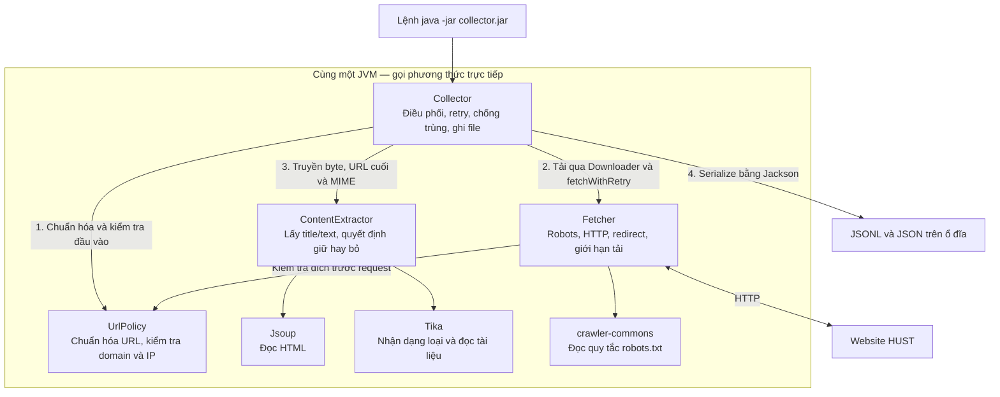
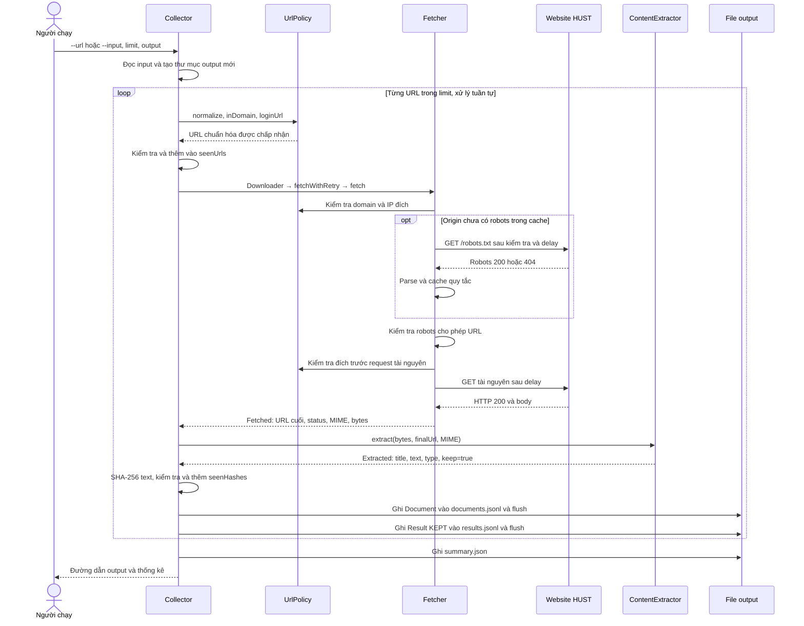
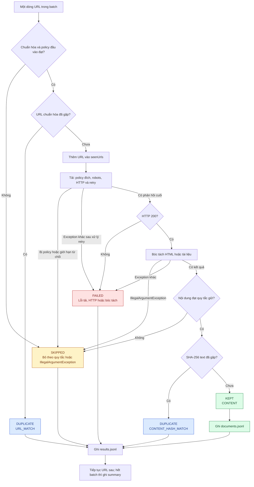
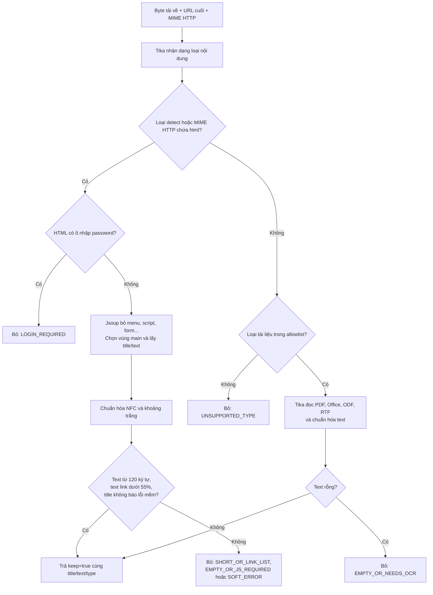
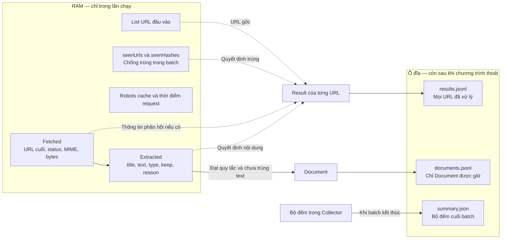
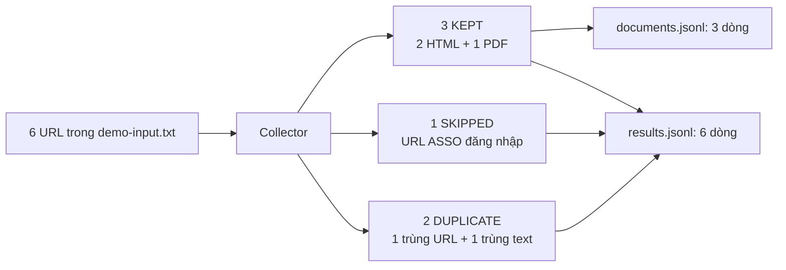

# Mô hình thiết kế bằng sơ đồ

Đọc từ trên xuống: hệ thống làm gì → class nào phụ trách → một URL đi qua các bước nào → dữ liệu được ghi ở đâu. Các sơ đồ mô tả code hiện tại, đối chiếu ngày 05/09/2026. Quy tắc đầy đủ nằm trong [thiết kế chi tiết](architecture.md).

Các khối `mermaid` hiển thị thành hình trong trình xem Markdown hỗ trợ Mermaid, chẳng hạn trên GitHub. Nếu IDE chỉ hiện mã sơ đồ, mở file bằng chế độ Markdown preview có hỗ trợ Mermaid.

## 1. Toàn cảnh: đầu vào và sản phẩm cuối

Bạn cung cấp URL. Collector tải và chuyển nội dung thành văn bản cùng báo cáo. Các file output nằm trên máy chạy lệnh; chức năng index/tìm kiếm sẽ là bước phát triển sau.

## 2. Bốn class phối hợp như thế nào?

**Collector là đầu mối điều phối.** Fetcher trả byte về Collector; Collector mới gọi ContentExtractor. Fetcher không trực tiếp gọi extractor. `Downloader` là điểm thay thế cách tải trong test; production truyền một lambda gọi Fetcher có retry.

| Nếu muốn hiểu hoặc sửa… | Đọc class |
|---|---|
| Lệnh chạy, limit, retry, chống trùng, output | [Collector](../src/main/java/vn/edu/hust/collector/Collector.java) |
| URL nào được chấp nhận | [UrlPolicy](../src/main/java/vn/edu/hust/collector/crawl/UrlPolicy.java) |
| Cách tải và xử lý robots/redirect | [Fetcher](../src/main/java/vn/edu/hust/collector/crawl/Fetcher.java) |
| Vì sao nội dung được giữ/bỏ | [ContentExtractor](../src/main/java/vn/edu/hust/collector/extract/ContentExtractor.java) |

## 3. Một URL được giữ: ai gọi ai, theo thứ tự nào?

Sơ đồ này minh họa đường đi thành công của một URL mới, chưa trùng text. Các nhánh lỗi nằm ở sơ đồ tiếp theo.

Nếu tài nguyên redirect, Fetcher kiểm tra lại đích mới và robots của đích đó trước khi tải tiếp. Nếu lỗi I/O hoặc phản hồi tài nguyên 429/5xx, Collector thử tối đa 3 lượt tổng cộng. Không phải mọi lỗi robots đều được retry; xem [thiết kế HTTP](architecture.md).

## 4. Vì sao URL thành KEPT, SKIPPED, DUPLICATE hoặc FAILED?

**Trùng URL được phát hiện trước tải; trùng text được phát hiện sau bóc tách.** URL được đánh dấu đã gặp trước khi tải nên một URL từng tải lỗi vẫn bị `URL_MATCH` khi xuất hiện lại trong cùng batch. Sơ đồ giả định ghi file thành công; lỗi filesystem có thể dừng cả batch.

## 5. Bên trong ContentExtractor

Sơ đồ này mô tả các kết quả bình thường của extractor; exception được Collector xử lý như sơ đồ 4. HTML dùng ngưỡng độ dài/tỷ lệ link, còn tài liệu chỉ cần text không rỗng. Các nhãn “JS_REQUIRED” hoặc “NEEDS_OCR” là tín hiệu xem lại, chưa phải kết luận chắc chắn về nguồn.

## 6. Dữ liệu nào tạm thời, dữ liệu nào còn sau khi thoát?

Không lưu raw HTML/PDF. Chạy lại tạo cache/tập chống trùng mới và cần thư mục output mới. JSONL được flush từng record; summary chỉ có khi batch kết thúc bình thường. Hai file JSONL không được ghi trong một transaction.

## 7. Đối chiếu với mẫu thật trong repo

Đây là [kết quả lịch sử đã commit](../output/demo-n06/results.jsonl), có 0 FAILED và 0 remaining. Chạy lại trên website thật có thể cho kết quả khác. Để đọc code theo sơ đồ: bắt đầu từ `Collector.main → run → process`, rồi mở Fetcher hoặc ContentExtractor tùy bước muốn tìm hiểu.
