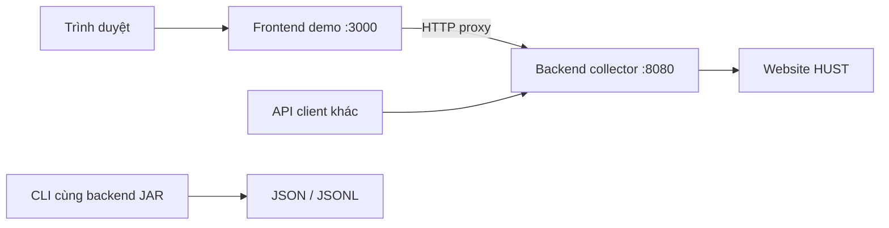
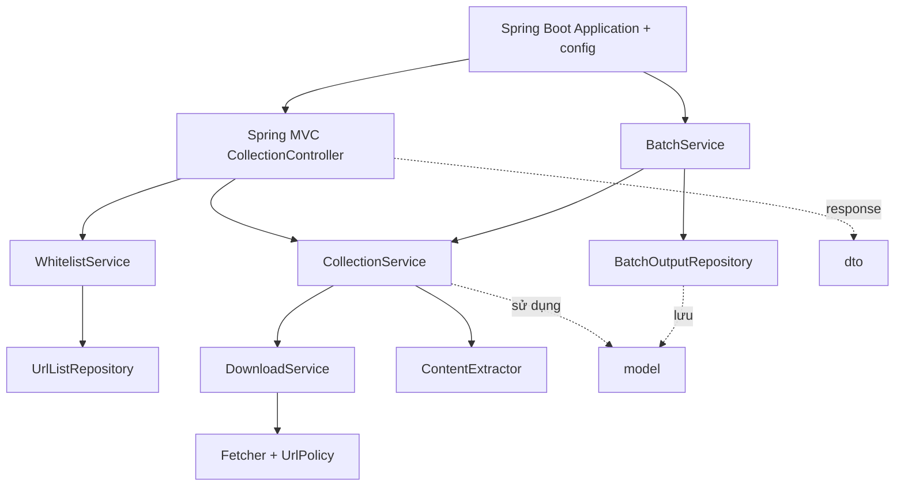
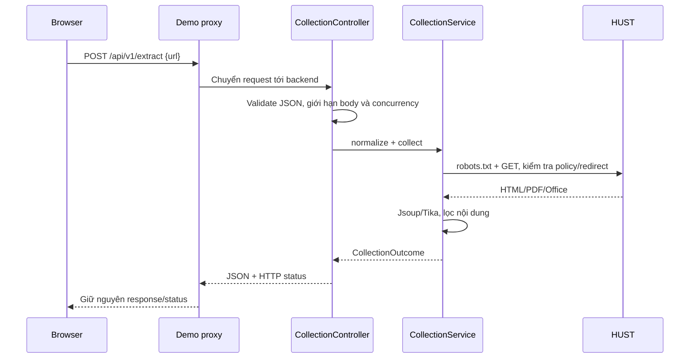
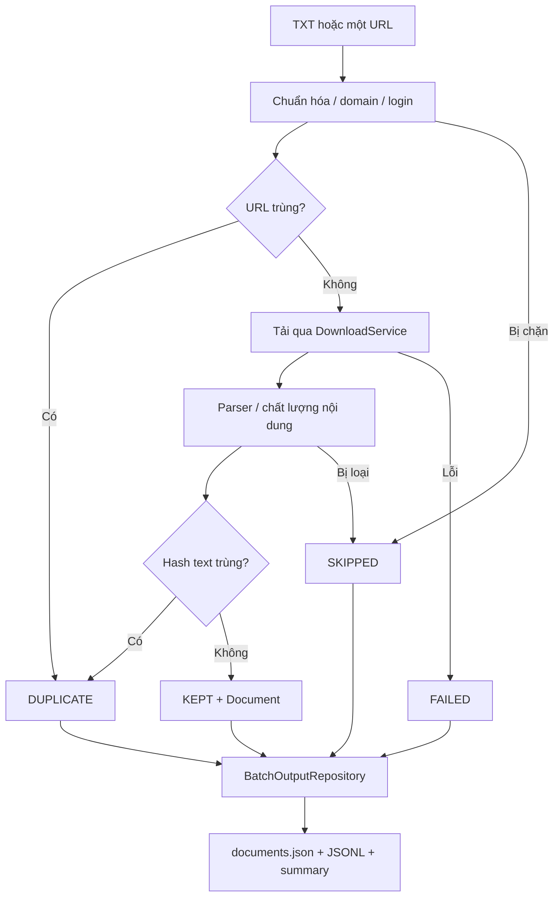

# Sơ đồ kiến trúc

Một backend, các layer gọi nhau trong cùng JVM. Frontend chỉ là demo tùy chọn.
Chi tiết quy tắc thu thập: [architecture.md](architecture.md).

## Triển khai

Frontend không cần thiết để chạy API/CLI. Docker Compose có một backend và
profile `demo` để bật giao diện khi trình diễn.

## Layer trong backend

Controller xử lý HTTP, service chứa nghiệp vụ, repository truy cập dữ liệu.
Model không phụ thuộc layer khác. `crawl`/`extract` là thành phần trong backend.

## Một request qua frontend demo

## Batch

