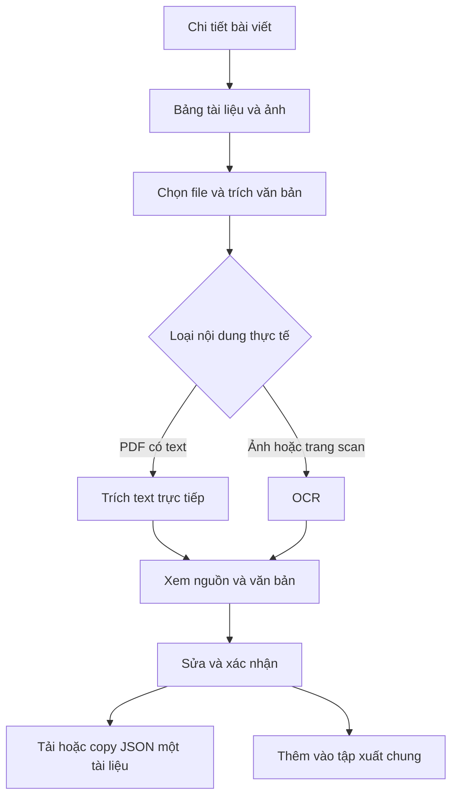

# Đề xuất trích văn bản từ ảnh và PDF liên kết

Trạng thái: **thiết kế đề xuất, chưa triển khai và chưa chốt toàn bộ lựa chọn**.
Tài liệu này không mô tả tính năng đang có. Chưa chọn engine OCR, chưa thêm dependency,
endpoint, nút giao diện hoặc thay đổi schema hiện tại.

## 1. Mục tiêu

Đưa chữ trong ảnh thông báo và PDF đính kèm thành văn bản có thể xem, chỉnh sửa và
xuất JSON cho TF-IDF. Giữ nguồn tài liệu để đối chiếu kết quả nhận dạng.

Hiện tại hệ thống đã lấy URL liên kết/ảnh trong bài viết. PDF được nhập trực tiếp
có thể trích text bằng Tika; chưa có pipeline OCR được cấu hình và kiểm chứng.
Không tự truy cập các liên kết trong kết quả thu thập.

## 2. Phạm vi phiên bản đầu đề xuất

- Người dùng chọn ảnh/PDF từ chi tiết bài viết và chủ động bấm trích văn bản.
- PDF có text: trích trực tiếp; trang scan cần nhận dạng mới dùng OCR.
- PDF hỗn hợp cần xét theo trang để tránh bỏ sót trang scan hoặc nhân đôi text.
- Mỗi file là một văn bản riêng, giữ quan hệ với bài viết nguồn.
- Cho xem, sửa text rồi thêm vào tập xuất hoặc tải/copy riêng.
- Không theo link HTML sang bài khác; không tự quét tất cả file trong cả lô.

Giới hạn khởi điểm đề xuất: 5 tài liệu/lượt, 10 MiB/file, 20 trang/PDF, xử lý tuần tự.
Đây chưa phải cấu hình thực tế. Cần đo với dữ liệu mẫu trước khi chốt timeout,
độ phân giải ảnh và giới hạn tổng số pixel.

## 3. Luồng giao diện



Bảng đề xuất: chọn, tên/mô tả, loại dự kiến, trạng thái và thao tác.
Phần mở rộng URL chỉ dùng gợi ý loại file; backend phải kiểm tra nội dung tải thực tế.
Không lấy logo hoặc ảnh trang trí mặc định; người dùng quyết định tài liệu cần đọc.

Khi xem kết quả, hiển thị URL file, bài viết nguồn, cách trích và text chỉnh sửa được.
Với PDF, giữ dấu mốc trang trong dữ liệu nội bộ để đối chiếu. Việc xem trước file và
định dạng metadata trang cần chốt khi triển khai, không mặc định đã hỗ trợ.

Đóng hộp thoại chỉ đóng phần xem. Nếu cho phép xử lý tiếp khi đóng, trạng thái phải
vẫn xuất hiện trong bảng. Nút Dừng ngăn bắt đầu file mới; cách hủy tác vụ đang chạy
phải phù hợp với engine OCR và được kiểm thử riêng.

## 4. Trạng thái và lỗi

| Trạng thái đề xuất | Ý nghĩa / thao tác |
|---|---|
| Chưa xử lý | Có thể chọn và bắt đầu |
| Đang tải / đang trích | Hiển thị hoạt động, khóa thao tác chạy lại cùng file |
| Chờ duyệt | Có text, cho xem và sửa; chưa tự thêm vào tập xuất |
| Đã thêm | Có trong tập dữ liệu xuất chung |
| Trùng nội dung | Không thêm bản text giống hệt vào tập xuất |
| Lỗi | Nêu nguyên nhân, cho thử lại chủ động |
| Đã dừng | Giữ các kết quả đã hoàn thành |

Phân biệt: URL bị từ chối, tải thất bại, loại file không hỗ trợ, vượt giới hạn,
PDF mã hóa, timeout, engine chưa sẵn sàng và không nhận dạng được chữ.
Lỗi một tài liệu không làm mất bài viết gốc hoặc kết quả tài liệu khác.
Không hiển thị phần trăm tiến độ giả nếu engine chỉ báo bắt đầu/kết thúc.

## 5. Dữ liệu và TF-IDF

Mỗi file là một document riêng. Ví dụ minh họa schema **đề xuất**, không phải API đã có:

```json
[
  {
    "title": "Điều kiện xét học bổng",
    "text": "Nội dung đã được kiểm tra...",
    "url": "https://hust.edu.vn/tai-lieu.pdf",
    "sourceUrl": "https://hust.edu.vn/thong-bao.html",
    "extractionMethod": "ocr"
  }
]
```

`url` trỏ tới file; `sourceUrl` trỏ tới bài chứa liên kết. `extractionMethod` dự kiến
phân biệt `direct` và `ocr`; trường hợp PDF hỗn hợp cần định nghĩa thêm khi chốt schema.
Frontend TF-IDF hiện nhận `text`, `title`, `url`, `id`; trường bổ sung bị bỏ qua khi
lập chỉ mục, nên muốn hiển thị nguồn bài gốc trong kết quả tìm kiếm phải mở rộng riêng.

Giữ text gốc nhận dạng và bản chỉnh sửa trong phiên để người dùng có thể đối chiếu;
chỉ xuất bản đã xác nhận. Text rỗng không được thêm vào corpus.
Kiểm tra trùng lại sau chỉnh sửa. Không nối mặc định text đính kèm vào bài gốc vì
việc đó thay đổi độ dài tài liệu và tần suất từ dùng khi tính TF-IDF.

PDF dài có thể cần chia theo trang/mục sau này; phiên bản đầu đề xuất một file là
một document để dễ quản lý và đối chiếu. Không coi lỗi OCR là từ đúng trong dữ liệu mẫu đánh giá.

## 6. Hướng triển khai kỹ thuật

Tận dụng kiểm tra URL, tải có giới hạn và trích PDF hiện có. OCR bổ sung ở backend,
không đưa xử lý nặng vào vòng lặp sự kiện frontend. Chưa cần quyết định thêm service
hoặc hàng đợi trước khi đo thời gian và cách chạy engine trên Windows.

Trước khi chọn engine, thử một tập nhỏ gồm ảnh thông báo tiếng Việt, PDF scan,
PDF có text và PDF hỗn hợp. Đánh giá chất lượng dấu tiếng Việt, thứ tự đọc nhiều cột,
thời gian, RAM và khả năng cài trên máy chạy demo. OCRmyPDF/Tesseract chỉ là ứng viên,
không phải dependency đã được dự án chọn.

Chế độ bỏ qua trang đã có text là một khả năng được OCRmyPDF mô tả tại
[tài liệu xử lý nâng cao](https://ocrmypdf.readthedocs.io/en/stable/advanced.html).
Không suy ra rằng kiểm tra có text là đủ cho mọi trang chứa cả ảnh và chữ.

API OCR và cách trả tiến độ chưa chốt. Dù dùng request trực tiếp hay tác vụ nền,
phải phân biệt lỗi từng file, giới hạn tác vụ đồng thời và hủy/timeout rõ ràng.
Không tự động retry OCR tốn tài nguyên khi người dùng chưa yêu cầu.

## 7. Giới hạn tài nguyên và nguồn tải

Tiếp tục dùng kiểm tra domain/IP/redirect và giới hạn tải của backend cho URL file.
Liên kết xuất ra có thể ở ngoài HUST; điều đó không đồng nghĩa backend được phép tải nó.
Không tự mở rộng domain policy để chạy OCR.

Cần kiểm tra số trang và kích thước ảnh giải mã trước khi render/OCR; file nén nhỏ
vẫn có thể tạo ảnh rất lớn. Đặt timeout thực cho tiến trình OCR, dọn file tạm sau
thành công/lỗi/hủy và tránh dùng tên file từ URL làm đường dẫn ghi tùy ý.

Kết quả trong RAM chỉ sống trong phiên trình duyệt nếu chưa thêm lưu trữ. Nếu muốn
resume sau tải lại trang hoặc chạy nền qua nhiều phiên, phải thiết kế lưu trạng thái
riêng; không hứa hỗ trợ trong phiên bản đầu.

## 8. Tiêu chí nghiệm thu khi triển khai

1. PDF có text trích được nội dung mà không OCR toàn bộ một cách không cần thiết.
2. Ảnh tiếng Việt và PDF scan tạo text xem/sửa được; lỗi có thông báo rõ.
3. PDF hỗn hợp không mất trang scan, không nhân đôi lớp text.
4. File lỗi hoặc quá giới hạn không làm mất kết quả thành công trước đó.
5. Tải/copy riêng chỉ chứa tài liệu đang xem; xuất chung chỉ chứa mục đã xác nhận.
6. JSON xuất ra nạp được vào TF-IDF; tìm được từ đã kiểm tra trong tài liệu mẫu.
7. Đóng, hủy, thử lại, nội dung trùng và dọn file tạm hoạt động đúng.
8. Domain/redirect vẫn được kiểm tra; engine không chạy vô hạn hoặc vượt giới hạn đặt ra.

## 9. Các điểm cần chốt trước khi viết chức năng

- Chọn engine sau thử nghiệm tiếng Việt trên môi trường chạy thực tế.
- Chốt giới hạn, timeout, ngôn ngữ nhận dạng và có cần chọn khoảng trang hay không.
- Chốt cách đưa tài liệu đã duyệt vào tập xuất và cách lưu sửa đổi trong phiên.
- Chốt request trực tiếp hay tác vụ nền dựa trên thời gian xử lý đo được.
- Chốt metadata cho PDF hỗn hợp và nhu cầu truy xuất từng trang.

Tài liệu chức năng hiện tại: [thu thập](demo.md), [TF-IDF](search.md),
[kiến trúc](architecture.md), [kiểm thử](validation.md).
